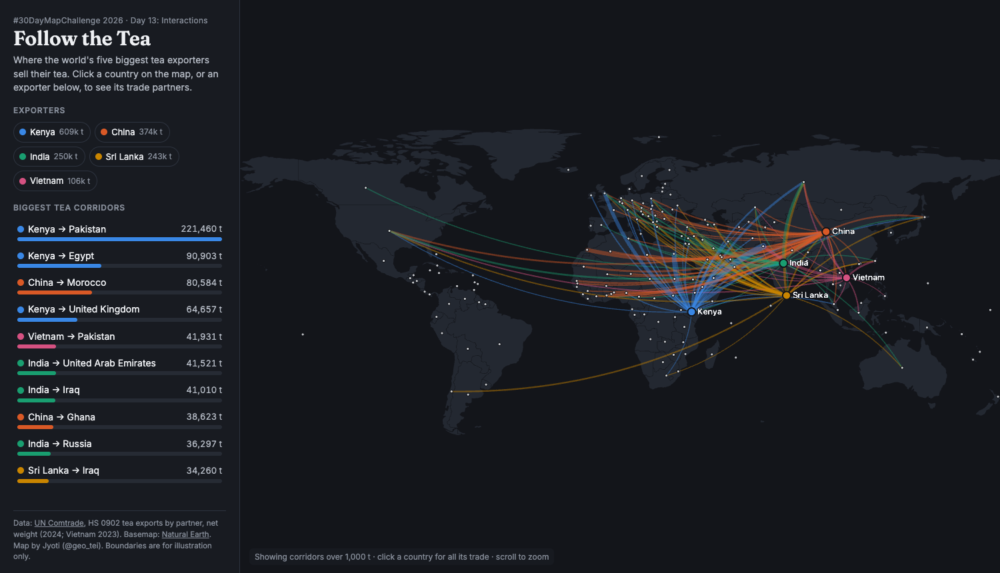
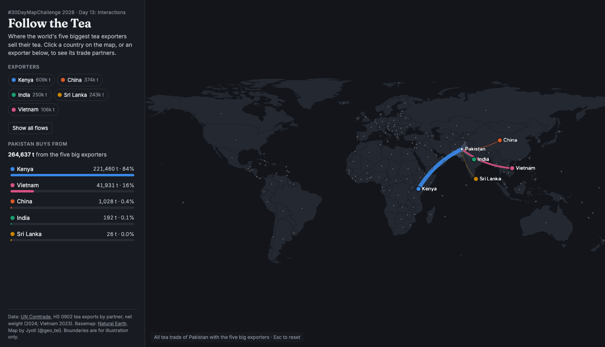
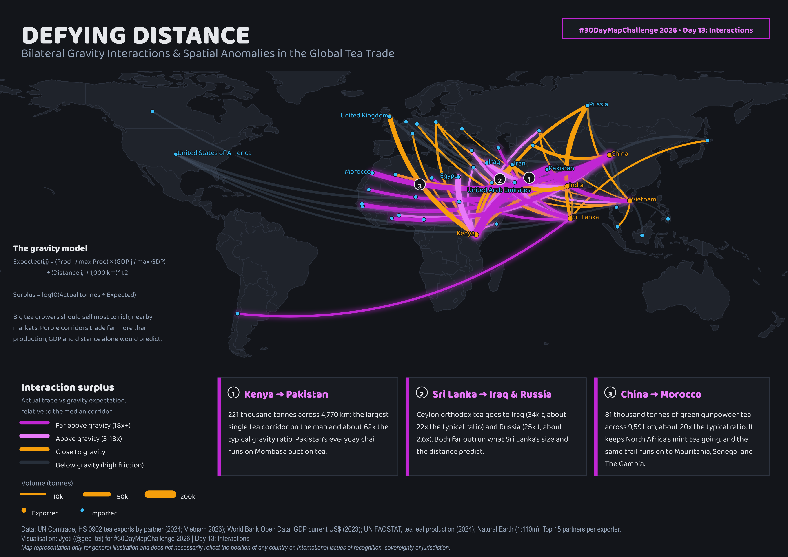

# Top 5 Tea Exporters: Where the World's Tea Goes

#30DayMapChallenge 2026, Day 13: **Interactions**

**Live interactive map:** https://geo-ti.github.io/top-5-tea-exporters/V2/day13_follow_the_tea.html

Tea exports from the world's five biggest exporters (Kenya, China, India, Sri Lanka and Vietnam) to more than 170 countries, from UN Comtrade trade data (HS 0902). Two versions of the map are included:

| | V2: Follow the Tea (interactive) | V1: Defying Distance (static) |
|---|---|---|
| Idea | Click any country to see who it buys tea from or sells tea to | A gravity model flags corridors that trade far more (or less) than production, GDP and distance predict |
| Built with | Python + deck.gl | Python + QGIS |
| Output | `V2/day13_follow_the_tea.html` | `V1/day13_defying_distance.png` |

## V2: Follow the Tea



Selecting a country shows all of its trade with the big five. Pakistan, for example, gets 84% of its tea from Kenya:



Open `V2/day13_follow_the_tea.html` in a browser. It is a single file that loads deck.gl from a CDN.
- Add `#PAK`, `#KEN`, `#MAR` and so on to the address to open with that country selected.
- Add `?theme=light` or `?theme=dark` to force a theme.

## V1: Defying Distance



Expected(i,j) = (Prod_i / max Prod) x (GDP_j / max GDP) / (D_ij / 1,000 km)^1.2

Arc colour shows actual tonnes divided by this expectation, relative to the median corridor. The strongest anomalies are:
- Kenya -> Pakistan
- Sri Lanka -> Iraq
- China -> Morocco and on into West Africa

## Repository layout

```
procure_data_day13.py   download Comtrade, World Bank GDP and Natural Earth 110m into data/
data/                   downloaded data, plus data/inputs/ (FAOSTAT, Natural Earth 50m, India boundary)
SOURCES.md              data sources with links, and method notes
V1/                     static gravity-model map (GeoPackage, QGIS project, PNG)
V2/                     interactive web map (template, build script, HTML)
```

## Reproduce

Requires Python 3.11 with geopandas, pandas, numpy, shapely, pyogrio and requests, plus QGIS for V1's layout.

```bash
python procure_data_day13.py                      # optional: data/ is already included

cd V2 && python build_interactive_map.py          # -> day13_follow_the_tea.html

cd ../V1 && python compute_gravity_interactions.py   # -> tea_gravity_interactions_day13.gpkg
QT_QPA_PLATFORM=offscreen /Applications/QGIS.app/Contents/MacOS/python build_qgis_project.py   # -> .qgz + .png (macOS QGIS path)
```

## Data

- UN Comtrade: https://comtradeplus.un.org
- World Bank Open Data: https://data.worldbank.org
- UN FAOSTAT: https://www.fao.org/faostat
- Natural Earth: https://www.naturalearthdata.com

Details are in [SOURCES.md](SOURCES.md). Trade figures are net weight as reported by each exporter (2024; Vietnam 2023).

Map representation is for general illustration only and does not necessarily reflect the position of any country on international issues of recognition, sovereignty or jurisdiction.

Made by Jyoti (@geo_tei).
